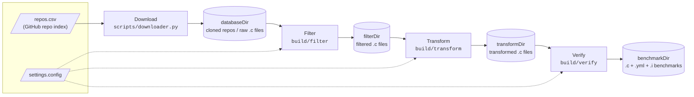
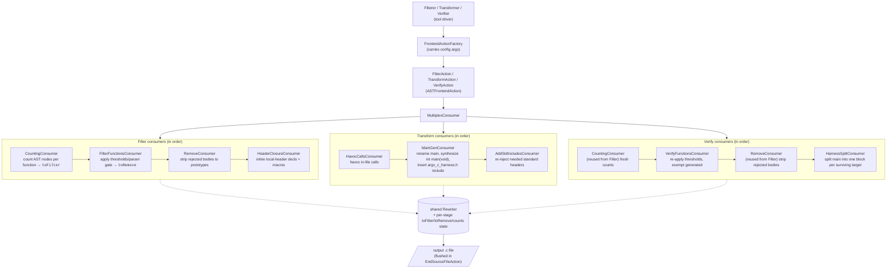

<!--
SPDX-FileCopyrightText: Copyright (C) 2026 The ARG-V Project

SPDX-License-Identifier: Apache-2.0
-->

# ArgV C Transformer - Design

This document is intended to describe the pipeline's design choices, the
trade-offs and roadblocks that motivated them, and what's explicitly unsupported.
For what the pipeline does and how to run it, see [`README.md`](../README.md).

Download, Filter, Transform, and Verify are four separate steps, not one
uniformly-configured pipeline: Download reads its own config
(`downloader.config`) and is never invoked by `argv-c`, while Filter,
Transform, and Verify share `settings.config` via `parsePipelineConfig`
(`src/common/include/ConfigParser.hpp`). See the [Tutorial](tutorial/Tutorial.md)
for a worked example of Download → Filter → Transform on a toy repo.



## Design Choices and Limitations

### Supported Types

Only C builtin primitives have `__VERIFIER_nondet_*` equivalents. The full set (defined in
`VerifierNames.hpp`):

`_Bool`, `char`, `signed char`, `unsigned char`, `short`, `unsigned short`, `int`,
`unsigned int`, `long`, `unsigned long`, `long long`, `unsigned long long`, `float`,
`double`

Types outside this set (structs, unions, enums, typedefs to non-builtins) are
**unsupported for parameter synthesis**. Functions with any unsupported parameter type
cannot be called in the generated harness and have their bodies stripped during filtering.

Pointer parameters are the exception: they are synthesized by allocating a real block
rather than inventing an address, so they are supported whenever `planPointer`
(`src/common/include/HavocPolicy.hpp`) finds a viable plan for the pointee (see "Pointer
Shapes" and "Pointer Depth" below). A function taking a non-viable pointer is
body-stripped like any other. The filter gates on the same classifier the transform
uses, so a pointer-param function survives filtering exactly when the harness can call it.

An integer parameter alongside a pointer parameter is clamped rather than left as a raw
nondet value: `MainGenConsumer::genCallHarness` bounds it with `if (n < 0 || n >= K)
abort();` (the signedness check dropped for unsigned types), where `K` is the fewest
elements in any pointer parameter's storage: `N` for a declared `T[N]`, else
`__HAVOC_ARRAY_ELEMS` (a mix emits `(N < __HAVOC_ARRAY_ELEMS ? N : __HAVOC_ARRAY_ELEMS)`
so the macro stays retunable). This
sidesteps guessing which parameter is "the length" from its name — every integer is
bounded by the element count of the storage that was actually declared for the pointer
parameters, so a genuinely-undersized block can't be indexed out of bounds regardless of
which parameter the callee treats as a length.

### Pointer Shapes

`planPointer` classifies every pointer or constant-array parameter/return into one
`PointerShape` (`src/common/include/HavocPolicy.hpp`), and `renderPointerStorage` turns a
viable plan into real stack storage for both a parameter or a hoisted return, so
the two call sites can't drift:

- **`CString`** : (`char*`/pointee is any character type) → `char b[__HAVOC_STR_MAX]`,
  filled and null-terminated in bounds by `__havoc_cstring_fill`.
- **`Array`** : a parameter spelled `T[N]`. `ParmVarDecl::getOriginalType()` preserves the
  pre-decay `ConstantArrayType`, so storage uses the declared bound `N` exactly rather than
  a generic size.
- **`Block`** : any other pointer to a sized type, no declared bound available →
  `T b[__HAVOC_ARRAY_ELEMS]`.
- **`Record`** : a struct/union pointee defined in the main file →
  `T b[__HAVOC_ARRAY_ELEMS]`. Pointers inside it are planned under "Pointer Depth" below.
- **`Opaque`** : `void*`, an incomplete type, or a record whose definition isn't in the
  main file → `unsigned char b[__HAVOC_BLOCK_MAX]`, cast to the declared pointer type.
- **`Function`** : never viable; no value can be synthesized for a function pointer.

Every shape besides `Function` gets filled storage, and its declared element count bounds
whatever indexing the callee does into it. With `havocFieldwise` (the default), typed
storage is filled with one typed `__VERIFIER_nondet_<type>()` per scalar element or field;
with it off, or at `havocPointerDepth=0`, the whole block is filled by
`__VERIFIER_nondet_memory`. `Opaque` storage, having no element type, is always
bulk-filled. Storage is on the stack, except for the freed pointer returns described under
"Memory Tracking" below.

### Pointer Depth

`havocPointerDepth` (default 1) bounds how far pointers *inside* storage are initialized.
Each one (a `T **` element, a record's pointer field, through embedded records and field
arrays) becomes a child plan with storage of its own, one row per parent element, and is
assigned after the fill, so no pointer value the callee dereferences is ever a raw nondet.
A pointer that would need storage past the bound makes the whole plan non-viable: the
function is not harnessed, or a pointer-returning call is rejected. It is deliberately not
set to `0`, which would plant a NULL dereference the input never had. A recursive type
(`struct Node { struct Node *next; }`) is therefore never viable at any finite depth.

Also non-viable, wherever they would need planning: a function-pointer field, a pointer
inside a union (assigning one member would clobber its siblings), a `const` pointer member
(it can't be assigned after the fill), and a record with a flexible array member (see
"What Is Not Supported").

Depth 0 is the generic pointer model: storage keeps its typed shape, so `clampIntegers`
still matches its element count, but it is always bulk-filled and no pointer inside it is
planned or assigned — those bytes stay nondet.

A struct or union tag first named inside a parameter list (`void f(struct Rect *r)`) has
*prototype scope*, invisible outside that declaration, so a harness cast to it would
name a distinct, incompatible type and fail to compile. `pointeeFwdDecl` detects this and
emits a file-scope forward declaration (`struct Rect;`), collected into a set shared by
`HavocCallsConsumer` (havocked pointer returns) and `MainGenConsumer` (harnessed pointer
parameters); `MainGenConsumer` writes the whole set into the file's prelude once every
call is known, since it runs last of the two. A repeated forward declaration is legal C
even when a full definition follows.

An anonymous struct or union with no typedef (`struct { int x; } *p`) has no name to
spell, and every shape needs one: the storage declaration (`T b[N]`) and the harness
cast both have to write the pointee's type. `isSpellable` checks for this, and an
unspellable pointer is not viable wherever it appears. As a parameter or return, it is
rejected at every depth, including 0, where the `Opaque` cast still has to name it. As a
pointer field (`struct Outer { struct { int x; } *inner; }`), it makes the enclosing
plan non-viable at any depth that would give `inner` storage. It is deliberately not
set to `0`: that would plant a NULL dereference the input never had, which is the same
reasoning that rejects a pointer past the depth bound. The restriction is only on
*naming* the pointee. A typedef'd anonymous record (`typedef struct { ... } S;`) is
spelled through its typedef and is fine, and so is an anonymous member embedded by value
(`struct { int *p; };` inside a record): it needs no storage of its own, and its pointer
fields are reached through the parent as `parent.p`.

### Intraprocedural by Design

Each function body is made self-contained: calls to other functions *in the same file*
are replaced with nondeterministic values (havocked). This means the benchmark exercises
each function in isolation; interprocedural reasoning is not tested. Library calls
(C stdlib, system headers) are kept because they have well-known semantics that verifiers
model directly.

### Body-Stripping vs Deletion

Removed functions are body-stripped to bare prototypes (`void f(int x);`), not deleted
entirely. This is intentional: the Transform step's `HavocCallsVisitor` needs the
callee's declaration to resolve its return type when replacing calls. Without the
prototype, the return type would be unknown and the havoc replacement couldn't determine
which `__VERIFIER_nondet_*` variant to use.

### Main Handling

`main` receives special treatment throughout the pipeline:

- **Filter**: subject to the same complexity/feature thresholds as any other function; a
  `main` that doesn't meet them gets body-stripped too. It's exempt only from the
  parameter-type gate, so its `argc`/`argv` pointer params never trigger removal on their
  own.
- **Transform**: renamed to `original_main` and called from a synthesized `main(void)`.
  For `main(int, char**)`, the pointer params have a well-defined contract (unlike an
  arbitrary `void *`), so we synthesize a realistic `argc`/`argv` using havocked C strings
  rather than skipping the function.
- **Verify**: the *generated* `main` is exempt from the threshold re-check (it's harness
  scaffolding, not benchmark content); `original_main` is subject to thresholds like any
  function, but no parameter gate is re-applied, so its `argc`/`argv` never trigger
  removal.
- The `argc` bound (default `1–4`) and `argv` string size (default `16` bytes) keep the
  verifier's state space bounded. They are emitted into each benchmark as the
  `__HAVOC_ARGC_MIN` / `__HAVOC_ARGC_MAX` / `__HAVOC_STR_MAX` macros rather than inlined
  as literals, so a generated benchmark can be retuned without rerunning the pipeline;
  the values come from `[Havoc Settings]` in the config, falling back to the constants in
  `src/common/include/HavocBounds.hpp`.
- `argc` has its own bound rather than sharing `havocArrayElems`, for the same reason
  any other integer is clamped to its pointers' element count: an integer is bounded by the
  storage it indexes, and argv's rows are sized `__HAVOC_ARGC_MAX × __HAVOC_STR_MAX`, not
  by the generic block size. The two also scale differently. An extra array element is
  usually one scalar, but an extra argument is a whole symbolic string, typically fed
  through `strcmp`/`getopt`/`atoi`. Tying them together would mean growing arrays to
  explore array-heavy code also grows every `main(argc, argv)` benchmark's argv. Besides,
  the right `argc` range follows from the program's CLI contract (how many arguments it
  expects), which has nothing to do with its data structures.
- Most programs reject unexpected argument counts early (`if (argc != 3) usage();`),
  so a loose `argcMax` usually costs little, because the extra values die on a short
  path. That changes for programs that check only a minimum, or that loop over every
  argument (`for (i = 1; i < argc; i++)` over files or `getopt` options). There, each
  extra argument is a full symbolic string the verifier has to parse.

### Pointer Returns in Havocking

When havocking a call that returns a pointer, a raw nondet pointer value cannot be used
(dereferencing an arbitrary address is undefined behavior). Instead, `HavocCallsVisitor`
runs the return type through the same `planPointer`/`renderPointerStorage` pair the
harness uses for parameters (see "Pointer Shapes" above), hoisting a uniquely-named stack
buffer declaration above the call's enclosing statement so it outlives the call, and
replacing the call with a plain-C reference to that storage. The buffer is on the stack
unless the function frees the result (see "Memory Tracking" below). A non-viable plan (a
function pointer, or a pointer structure past `havocPointerDepth`) can't be havocked, so
the call is rejected and its enclosing function discarded (see "Rejected Calls" below); a
pointer return whose value is discarded is dropped.

### Memory Tracking

Pointer storage is created in two places: the storage that replaces a havocked pointer
return inside a function body, and the storage the generated `main` passes for each
pointer parameter. Both are stack arrays by default. The memory-safety properties
(`valid-free`, `valid-memtrack`, `valid-memcleanup`) depend on where that storage lives,
so the choice of stack or heap decides which memory errors a benchmark can contain.

The guiding rule is that the transform must not plant a memory error in a function's
own code that the input program did not have. Hiding a real one is accepted for now.

**Havocked returns.** When the enclosing function passes the stored result to library
`free` or `realloc`, the code treats it as owned heap memory, so stack storage would
turn a correct free into an invalid one. In that case the storage is allocated with
`malloc` instead:

```c
// input                          // output
char *buf = fetch();              char *__hret0 = malloc(sizeof(char) * __HAVOC_STR_MAX);
...                               char *buf = __havoc_cstring_fill(__hret0, __HAVOC_STR_MAX);
free(buf);                        ...
                                  free(buf);
```

The check (`HavocCallsVisitor::resultIsFreed`) finds where the call's value is stored:
the variable it initializes, or the variable or member chain (`s->buf`, `s.buf`) it is
assigned to, through parentheses, casts and the arms of a conditional. It then looks
for a library `free`/`realloc` in the same function whose argument names that location,
or a local copied from it in one step (`p = buf; free(p);`). Declarations are compared,
never names. A free inside another in-file function is ignored, since that call is
havocked away. Only the top-level storage moves to the heap; storage for pointers
inside it stays on the stack. SV-COMP assumes `malloc` never fails, so no NULL check is
emitted.

Every other return keeps stack storage. Always using the heap would plant leaks the
input never had, for example for a callee that returns a pointer into a static buffer.
Two gaps are accepted:

- Heap storage freed on some paths and returned or kept on others leaks. The input
  would have handed that memory to its caller.
- A real callee that allocates its result, called by code that never frees it, is a
  real leak in the input. Stack storage hides it. Exposing it requires knowing what the
  callee does, which is interprocedural by definition. When that lands, the decision
  gains a callee side (heap when the callee returns memory it allocated) next to the
  caller-side free check.

**The harness boundary.** The generated `main` stands in for an unknown caller, and no
attempt is made to honor the ownership contract between a target and its callers:

- A target that frees its pointer parameter (`void destroy(T *p) { free(p); }`) is
  passed stack storage, so the verifier reports an invalid free.
- A target that returns memory it allocated has that pointer discarded by `main`, so
  the verifier reports a leak.

Both are deliberate. Intraprocedurally, a benchmark is about the function alone, and
the caller's half of the contract (passing heap memory, freeing the result) is not part
of it. A verifier finding at that boundary is a fact about what the function does with
arbitrary inputs, and the benchmark is valid. Fixing either case would also need
knowledge the harness does not have: heap-allocating a parameter freed only on some
paths makes the harness leak it on the others, and freeing a returned pointer is only
sound when the target really returns owned heap memory rather than a static buffer or a
pointer into its own argument.

### Rejected Calls

A call whose return can't be havocked (aggregate/struct, or a non-viable pointer
plan) is rejected: `classifyCall` returns `Reject` instead of `nullopt`.
`VisitCallExpr` walks up to the enclosing `FunctionDecl` and taints it;
`HavocCallsConsumer` strips a tainted function to a bare declaration — same as a
no-op collapse — and excludes it from the harness.

This is not a compile-check safety net: `checkCompilable` runs `clang
-fsyntax-only`, which accepts a call to an undefined function regardless of
linkage, so leaving the call in place would not have been caught downstream. The
problem is semantic: the callee may have no definition anywhere in the output (a
header-closure prototype, or a filter-rejected sibling), and even when it does,
leaving the call real breaks the intraprocedural guarantee every other havocked
call provides.

### Cleaning Up After Havocking

Havocking hollows statements out: `helper();` becomes a bare nondet call, and a
loop whose body and increment were both calls now spins on nothing — the
transform would have *manufactured* nontermination the source didn't have. Such
residue is erased, but only under a deliberately narrow rule:

> A statement is removed if it is side-effect-free **and** contains a call this
> run havocked.

The second condition is the important one. Without it the pass becomes a
dead-code eliminator, and a benchmark would diff against upstream in places
havocking never touched. Pure-but-untouched code stays exactly as written.

A havocked call counts as side-effect-free because the transform is
intraprocedural: the callee's writes to globals and out-parameters are discarded
already, so the call contributes only its return value. A library call, or a
rejected call (see "Rejected Calls" above), is real and stays side-effecting;
it blocks removal, but a rejected call's enclosing function is discarded
separately regardless.

Because a statement can be erased after its inner calls were rewritten, verifier
declarations are decided only once traversal ends — otherwise an erased call
would leave a dangling `extern` that no compiler warning would catch.

### Include Stripping and Header Closure

The Filter step's `HeaderClosureConsumer` (`src/filter/HeaderClosure.{hpp,cpp}`) inlines
by value whatever the surviving code references out of project-local headers:
`RecordDecl`/`TypedefNameDecl`/`EnumDecl`/`VarDecl`/`FunctionDecl`, each emitted via
`Lexer::getSourceText` over its own source range, plus the macros it uses (collected by
its preprocessor half, `LocalHeaderPP`). The local `#include`s themselves are removed.
System headers are left as `#include`s, since the target machine provides them.

Transform's `IncludeFinder` still strips non-system `#include` directives, which matters
only for a standalone `transform` run on unfiltered input. Then for *standard/POSIX*
types we enforce during transformation:

- `AddStdIncludesConsumer` re-injects a standard header (`src/common/include/StdHeaders.hpp`)
  for a standard type or function it finds by walking the AST.
- `UnknownTypeDiagConsumer` patches the case where an unresolved standard type isn't even
  AST-visible. It scrapes the name straight out of the parser's `err_unknown_typename`/
  `err_undeclared_var_use` diagnostics and feeds it through the same `StdHeaders` lookup.

### Local Header Resolution

Filter and Transform resolve each file's quoted `#include "..."` directives against a
`HeaderIndex` (`src/common/include/IncludeIndex.hpp`) built once per run over
`databaseDir`, passing matches to Clang as `-I` search paths (`runToolOnFile`'s
`extraIncludeDirs`) so project-local headers actually parse instead of just being
stripped later. Basename collisions across the tree are disambiguated only by rebasing
the include's own subdirectory components onto the candidate directory; a spec with no
subdirectory that still matches more than one candidate just takes the closest one.

### Preprocessing Late, Not Early

The pipeline preprocesses once, at the end (`Verifier::preprocess`, `clang -E -P`). Filter
and Transform both work on real source with `#include`s intact. Preprocessing before
Transform instead would make `IncludeFinder`, `StdHeaders`/`AddStdIncludesConsumer`,
`HeaderClosure` and `pointeeFwdDecl` unnecessary, since they exist only because local
headers do not survive into the output. It is declined anyway, on two grounds:

- **`-E` is lossy and host-dependent.** It belongs downstream of everything that reasons
  about the input. Preprocessing at the end already broke a majority of CBMC runs through
  glibc's `_FloatNN` typedefs, which was repairable (`stripNoiseTypedefs`) only because the
  `.i` has no dependents.
- **The `.c` has to stay readable.** It is what a human audits; the verifier reads the
  `.i`.

The strongest argument for preprocessing early, that it replaces name-based guessing with
real definitions, is answered by header closure instead: definitions are inlined from
their own source spelling, so a header struct is sized `sizeof(T)`. Macro expansion is not
needed for havocking either, since a call inside a macro is rewritten where its text is
written (see "What Is Not Supported").

Two arguments against it do not hold and should not be relied on. Harness gating would
survive, because `isInMainFile` honours `# N` linemarkers, so `-E` *without* `-P` already
excludes header functions. And it is not an AST-cost question: measured on 40 files,
source and `.i` transform in the same time. The decision is cheap to reverse — a flag
change plus deletions.

### Preprocessor-Gated Code

The pipeline only operates on the **active** preprocessed translation unit. Functions inside
inactive `#ifdef` blocks (e.g. `#ifdef REDIS_TEST`) are invisible to all AST passes:
they are neither counted, filtered, havocked, nor harnessed. They pass through unchanged
as raw text.

### Assert Rewriting and Property Selection

Transform installs a second `PPCallbacks` hook alongside `IncludeFinder`: `AssertRewriter`
(`src/transform/include/TransformAction.hpp`, implemented in `TransformAction.cpp`) rewrites
every `assert(cond)` invocation in the main file into `if (!(cond)) reach_error();`. It
fires on `MacroExpands`, checks the expanded macro is function-like and named `assert`, and
locates the invocation's opening `(` and closing `)` in its source text — no AST node for
the call exists yet at that point in the pipeline. Only those two pieces are replaced
(`assert(` → `if (!(`, `)` → `)) reach_error()`), so the condition text stays editable by
later passes, e.g. havocking a call inside it. `reach_error` itself is defined
unconditionally in `argv_c_harness.h` as `void reach_error(void) { assert(0); }`; that
`assert` is never touched because it lives outside the main file, so there's no
self-rewriting loop.

SV-Comp's `unreach-call.prp` is checked as `LTL(G ! call(reach_error()))` — a property over
calls to a function with that literal name, not over `assert` or any C-level "reachability"
concept the verifier understands natively. Rewriting `assert` into `reach_error` is what
makes a benchmark's assertions visible to that check at all.

`CountingConsumer`'s `CountingVisitor` (reused unmodified between Filter and Verify) detects
a call to `reach_error` and sets the calling function's `Features.ReachError` flag — the
call is deliberately excluded from every other count, alongside nondet/havoc-helper calls,
so it doesn't skew the function's own metrics. `Verifier::selectProperties`
(`src/verify/Verifier.cpp`) reads the *post-transform* counts — the same map
`VerifyFunctionsConsumer` used for the threshold re-check — restricted to the one function
a benchmark harnesses (see "One Benchmark per Harnessed Function"), and picks `.prp` files
by structural signal:

- `ReachError` → `unreach-call.prp`
- `ForLoops` or `WhileLoops` → `termination.prp`
- `Operations` (a side-effecting op on a signed type) → `no-overflow.prp`
- `PointerDeref`, `MemAlloc`, or `MemFree` → `valid-memsafety.prp` (one file bundling the
  deref/free/memtrack CHECKs)

`writeBenchmarkTask` then emits the `.yml`: each selected property as an
`expected_verdict: true` block (a generated benchmark is never a deliberately-planted-bug
one, so every selected property is asserted to hold), pointing at `../properties/<name>.prp`
relative to `benchmarkDir`. An empty property list still produces a valid `.yml` (`properties:
[]`) but logs a warning, since a benchmark nothing was selected for is unlikely to be useful
to a verifier run.

### One Benchmark per Harnessed Function

`MainGenConsumer` emits each harnessed call, together with its argument setup, as its own
top-level `{ ... }` block of the generated `main`, ending in the call. Verify's
`HarnessSplitConsumer` cuts the reparsed file around those blocks into a shared head (everything
before the first block), a shared tail (everything after the last), and one block per
target, skipping any target `VerifyFunctionsConsumer` rejected on the re-check.

`Verifier::verifyFile` then writes one benchmark per surviving block,
`<stem>__<target>.c` = head + that block + tail, each with its own `.yml` (properties
selected from that target's counts alone) and `.i`. A single compile check covers them
all: the combined file (head + every block + tail) is written and checked first, and
since each benchmark is that file minus whole blocks, it compiles if the combined one does.
The combined file is then deleted, unless it failed the check with `keepCompilesOnly=false`,
in which case it is kept for inspection with no task file or `.i`.

Because properties come from the target's counts alone, a benchmark is never tagged with a
property (say `termination`) that only a sibling function's loops motivated.

### Empty Benchmark Discard

A file whose generated `main` calls no functions produces no benchmark. Transform checks
the written output with the text-based `harnessIsEmpty`
(`src/common/include/ClangToolUtils.hpp`), which looks for the exact verbatim empty main
`int main(void) {\n  if (0) reach_error();\n  return 0;\n}`. Verify discards a file when
`HarnessSplitConsumer` finds no surviving harness block, i.e. every target failed the
post-transform re-check.

### What Is Not Supported

- **Struct / union / enum parameters passed by value, and aggregate return types**: no
  `__VERIFIER_nondet_*` equivalent exists for aggregate types (see "Supported Types"
  above). A parameter of this kind gets the function body-stripped; a call *returning*
  one is rejected and its enclosing function discarded (see "Rejected Calls" above). A
  pointer *to* a struct/union is a separate case — see "Pointer Shapes" and "Pointer
  Depth".
- **Variadic functions** (e.g. `printf`-style): skipped with a warning; no way to
  synthesize a meaningful argument list
- **Function pointers, as a parameter or a return**: never viable (see "Pointer Shapes"),
  so a parameter of this kind is unsupported and a returning call is rejected
- **Flexible array members** (`struct Buf { int len; int data[]; }`): a pointer to such a
  record is not viable at any depth, wherever the member sits at depth >= 1 (directly or
  in an embedded record). Storage is an array of elements, `struct Buf b[N]`, and the tail is outside
  `sizeof`, so no element has room for it; the callee's `b->data[i]` would read into the
  next element, an out-of-bounds access the harness planted. Supporting it needs a
  single-element, aligned byte buffer with a fixed tail (`sizeof(struct Buf) + K *
  sizeof(int)`) plus a clamp on the in-struct length.
- **`envp` (third `main` parameter)**: `int main(int, char**, char**)` is not explicitly
  handled; only the first two parameters (`argc`, `argv`) are synthesized
- **Opaque definitions could introduce memsafety errors**: if for whatever reason some
  type is unresolved, it is still havocked as a flat `unsigned char b[__HAVOC_BLOCK_MAX]`
  block via the `Opaque` shape. However, if the real struct is larger, the callee could
  attempt out-of-bounds access, and a memory-safety verifier reports a violation that is an
  artifact of the harness. Mitigable today without code changes: `havocBlockMax` is
  emitted as a macro, so a benchmark can be retuned in place.
- **Some calls inside macros**: the Rewriter can't edit a macro *expansion*, so a call
  inside one is rewritten where its text is written — the whole macro use when the call
  is the entire expansion (`CHECK(v)`), the argument text (`MAX(helper(v), 3)`), or the
  `#define` body (which havocs every expansion). A call with no single contiguous spelling
  (`#define WRAP(f) (f(1) + 1)`), or a pointer-returning call inside a macro (no statement
  to hoist its storage above), is rejected and its enclosing function discarded, so a
  benchmark never silently stays interprocedural.
- **K&R-style (old-style) declarations**: the pipeline assumes ANSI-prototyped function
  declarations throughout (parameter typing, the filter's parameter-type gate, and
  `HavocCallsVisitor`'s callee resolution all read from `FunctionDecl::parameters()`).
  Old-style `int f(a, b) int a, b; { ... }` definitions are not explicitly detected or
  special-cased, and their behavior through the pipeline is untested
- **Typedef'd types**: a typedef to a supported builtin (e.g. `typedef int myint`) resolves
  correctly via `getAs<BuiltinType>()`, but a typedef to an unsupported type (e.g.
  `typedef struct foo bar`) is treated as unsupported

## Internal Structure: the Clang AST Pipeline Pattern

Filter, Transform, and Verify share the same Clang tooling skeleton. Each tool wires a
sequence of AST consumers into a `MultiplexConsumer`; all consumers share one `Rewriter`
and communicate through shared state passed into each consumer's constructor (Filter's
`toFilter` map and `toRemove` vector; Verify's `counts` map and its own `toRemove`).
The Rewriter's edited buffer is flushed to the output file in `EndSourceFileAction`.
Verify deliberately *reuses* Filter's `CountingConsumer` and `RemoveConsumer` rather than
reimplementing them, so the counting and stripping semantics cannot drift between the two
stages.



Verifier nondet naming, suffix→C-type mappings, and the `isVerifierGenerated`
generated-artifact check live in `src/common/include/VerifierNames.hpp`, shared by all
stages.

### Clang Version Portability

The pipeline supports Clang 20 through the current release. `CMakeLists.txt` enforces
only the floor, `scripts/install.sh` installs 20, and development happens on newer
releases, so the same source has to produce the same benchmarks on every version in
that range.

The AST is where versions drift, specifically in *sugar*: the wrapper `Type` nodes that
record how a type was spelled (`TypedefType`, `ParenType`, `AttributedType`, ...) without
changing what it is. Clang 21 removed `ElaboratedType`, so `struct S` is a bare
`RecordType` on 21+ but `ElaboratedType → RecordType` on 20. Code that tests the outermost
node with `dyn_cast<RecordType>` therefore succeeds on one version and silently fails on
the other — not a compile error, just a struct quietly misclassified.

The rule is to inspect types only through accessors that desugar: `getAs<T>()`,
`getAsTagDecl()`, `getAsArrayTypeUnsafe()`, `getPointeeType()`, `getCanonicalType()`.
These step past whatever sugar a given version inserts and are stable across the range.
Casting the *result* of one of them is fine; casting a raw `Type*` or a `TypeLoc` (whose
`getAs<T>()`, unlike `Type`'s, does not desugar) is not. Version-specific classes such as
`ElaboratedType` are not named at all; one that is genuinely unavoidable is fenced with
`#if CLANG_VERSION_MAJOR`.
